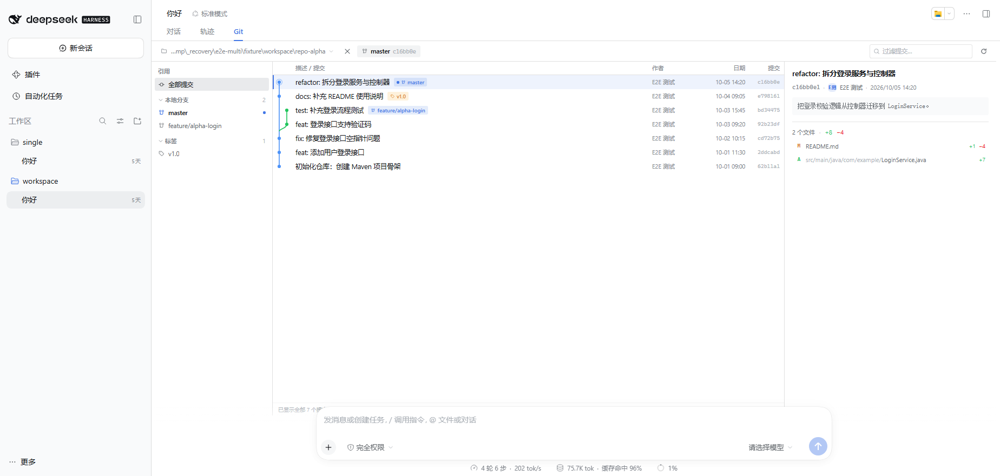
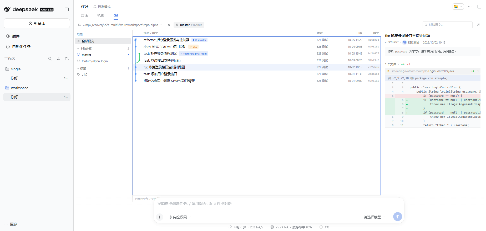
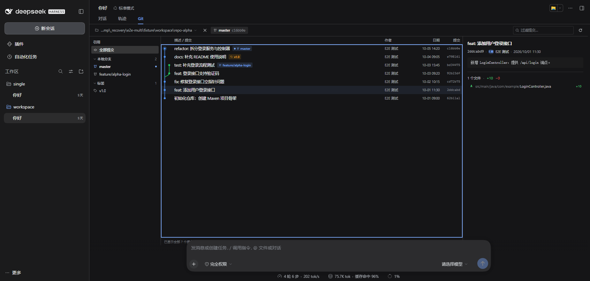
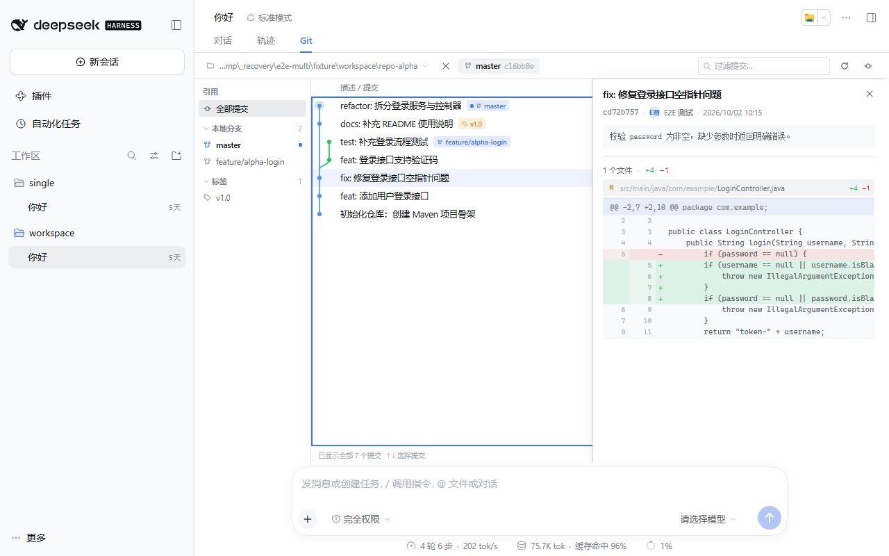
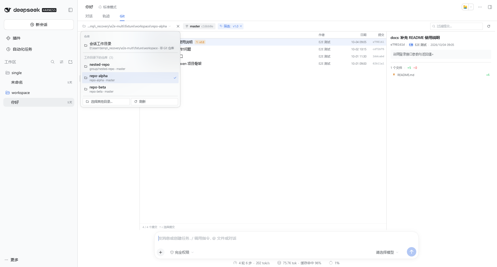
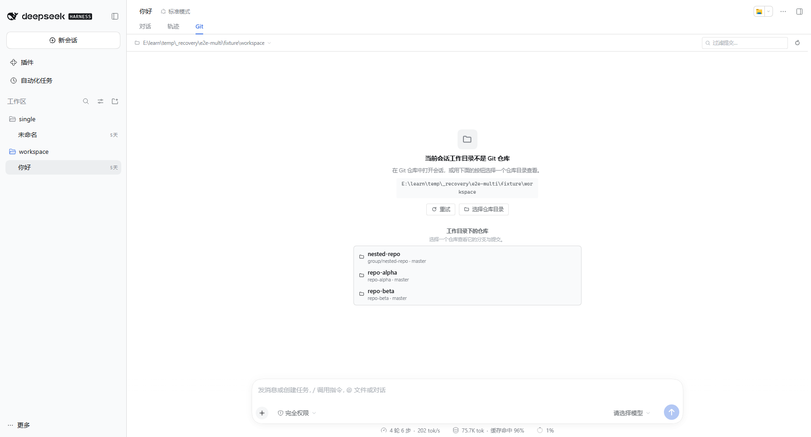
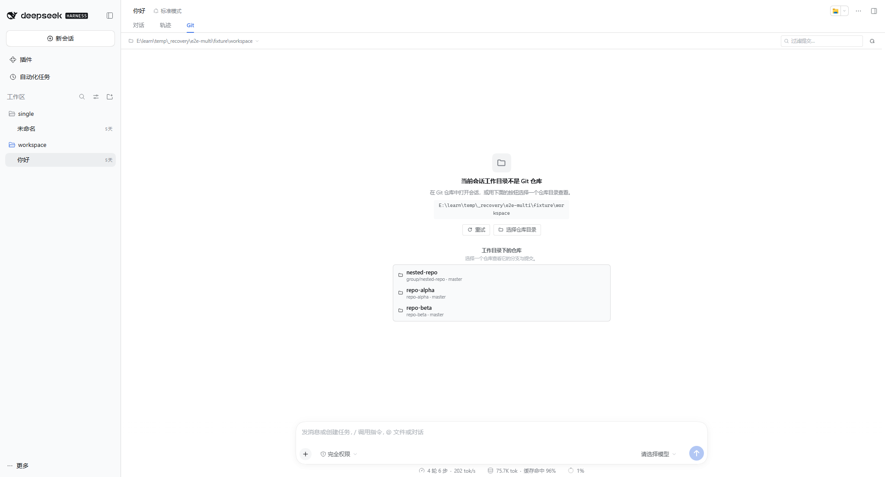

# dsh-git-graph · 会话视图：IDEA 风格 Git 树图

DeepSeek Harness（DSH）Web GUI 的**会话视图插件**：在会话头部的视图页签（对话 / 轨迹 / …）里增加一页 **Git**，
像 IDEA 的 Git 工具窗一样展示**当前会话工作目录**仓库的：

- **左列** 引用树：本地分支 / 远程分支 / 标签，HEAD 高亮；
- **中列** 提交列表 + 左侧 DAG 树图：分叉/合并曲线、lane 配色、HEAD 圆环、分支/远程/标签 pill、描述/作者/日期/短 sha；
- **右列** 选中提交详情：完整提交说明、作者与时间、变更统计、文件列表（A/M/D/R/C/T 状态与 `+n −n`），
  点开文件看**逐行 diff**（hunk 头、双行号、增删配色、重命名 old→new、二进制/截断提示）。

只读：只调用只读的 git 命令，不修改仓库，不写会话日志。深/浅色主题自动跟随，中英文切换跟随 DSH 语言。

**多仓库工作目录**：一个会话工作目录下可能有多个 Git 仓库（多项目目录 / monorepo）。视图会**递归探测**子目录里的仓库，
在工具栏提供**仓库切换下拉**；当前目录本身不是仓库时直接列出发现的仓库供点击进入；只发现 1 个时自动选中。
探测有界（深度默认 4、最多 50 个仓库、2000 目录 / 3s 预算），跳过 `node_modules`、`dist`、`.git`、隐藏目录与符号链接。

> 仓库地址：<https://github.com/jqstrong/dsh-git-graph>



| 文件 diff（行号 + 滚动） | 深色主题 |
| --- | --- |
|  |  |

窄窗口（1280×800，详情收成抽屉）：



多仓库工作目录（工具栏仓库切换下拉 / 非仓库时直接列出发现的仓库）：

| 仓库切换下拉 | 非仓库目录下的仓库列表 |
| --- | --- |
|  |  |

宽窗口（2048×1104，降级态仓库列表完整显示在输入框上方）：



> 以上截图来自一个纯虚构的演示仓库（`repo-alpha`：登录服务 + 控制器），不代表任何真实项目。

## 使用

1. 打开一个**工作目录是 Git 仓库**的会话（或先用「选择仓库目录」指定任意本地仓库）。
2. 点会话头部视图页签里的 **Git**。
3. 左列点引用过滤提交；中列点一行看右侧详情；右侧点文件名展开/收起该文件的 diff。
   支持键盘 `↑/↓/Home/End/PageUp/PageDown` 移动选中行，搜索框本地过滤（描述 / 作者 / sha，`Esc` 清空）。

当前会话目录不是仓库时，视图会显示「当前会话工作目录不是 Git 仓库」以及按钮：
**重试** / **选择仓库目录**（调用 DSH 原生目录选择器）/ **恢复会话工作目录**（清除手动选择的目录）。
若该目录下探测到了 Git 仓库，状态面板会直接列出这些仓库（名称 / 相对路径 / HEAD 分支），点选即可进入。
工具栏左侧的仓库路径可点击打开**仓库切换下拉**（会话工作目录 + 探测到的仓库列表 + 「选择其他目录…」/「刷新」），
也可用「选择其他目录」切换任意本地仓库。切换仓库时会清空当前引用过滤与选中提交，按新仓库的 HEAD/最新提交重新加载。

每个会话会记住自己上次选中的提交与手动选择的仓库目录（仅内存，不落盘）；切到别的视图再切回来、或切换会话后回来会恢复。

## 安装

前置：DSH 0.2.1-rc.2+（开发验证：桌面端 0.2.1-rc.3、CLI 端 0.2.1-rc.2 的独立 Web 实例）、
Host 有可执行的 `git`（PATH 中）。纯 Web / 桌面均可。

```powershell
git clone ssh://git@github.com/jqstrong/dsh-git-graph.git   # 或 https://github.com/jqstrong/dsh-git-graph.git
cd dsh-git-graph
node scripts/install.mjs          # 预演（默认 desktop profile，可用 --profile <dir>）
node scripts/install.mjs --yes    # 安装（link: 方式 + 追加到 dsh.profile.bundles）
node scripts/verify.mjs --base http://127.0.0.1:<DSH Web 端口>   # 静态 + 运行层校验
node scripts/uninstall.mjs --yes  # 卸载
```

安装脚本是幂等的：默认 dry-run；写入前自动备份 profile 的 `package.json` / `pnpm-lock.yaml` / `cordis.patch.yml`
到 `<profile>\.git-graph-install-backup\<时间戳>\`，任一步失败自动回滚。

安装后：

- 桌面端 HMR 会监听 profile manifest：`dsh.profile.bundles` 变化即热重组，通常**无需重启**；
  已打开的页面通过 `/plugins/events` 收到新的 boot graph，客户端 bundle 会即时加载。
- 如果页面上还没出现 Git 页签，**刷新一次页面**；仍不出现再重启 DSH。
- 卸载：`node scripts/uninstall.mjs --yes`（或 DSH 插件管理器里的 remove bundle）。

## 验证

```powershell
node check.mjs          # host 114/114 tests + client 71/71 checks
node check.mjs host     # 只跑 Host（在系统临时目录创建/清理临时仓库，约 17s）
node check.mjs client   # 只跑客户端纯逻辑 + React-stub 组件挂载
```

- **Host**：真实 `git` 临时仓库覆盖线性/分叉/合并/八爪鱼、根提交、分离 HEAD、空仓库、非仓库目录、裸仓库、
  中文/emoji/空格路径、多行提交说明、annotated/lightweight tag、重命名相似度、二进制、无结尾换行、
  超大 diff 截断、无 git 可执行文件、并发序列化、多仓库递归探测（depth=1/2、跳过规则、max/maxDirs/超时标志、
  worktree `.git` 文件、symlink 不跟随、head branch/detached/unborn），以及 HTTP 参数矩阵/错误码/`cwd` 优先/会话解析。
- **Client**：确定性 lane 布局（linear/merge/octopus/criss-cross/多根/截断）、相对时间、搜索、状态字母、
  引用树、选择默认值、windowing、分页去重、响应 envelope→错误映射、LRU/会话记忆上界、URL 与参数、
  多仓库菜单模型/自动选中判定/仓库响应归一化/视图高度钳制，
  以及组件挂载 smoke（首屏、点行→详情、点文件→diff、搜索/键盘、引用过滤、非仓库→仓库列表→切换、
  工具栏仓库下拉打开/切换/回会话目录、单仓库自动选中、空仓库/错误态、切换会话后恢复选中、样式表卸载）。
- **运行层**：`scripts/verify.mjs` 校验 profile 依赖/bundle 选择、公共 `/plugins/events` boot graph 包含本插件、
  bundle 实际被服务且包含 `conversation.view` 注册。
- **端到端（真实页面）**：隔离 DSH Web 实例（隔离 `DSH_HOME`）+ 无头 Chrome 打开真实页面并截图：
  会话头部出现 对话 / 轨迹 / **Git** 页签，点击后挂载三列视图；覆盖引用过滤、搜索、文件 diff（sticky 行号、
  横向滚动）、深色主题、窄窗口抽屉。多仓库场景另有独立隔离 e2e：`op=repos` HTTP 矩阵 37/37、页面流程 50/50，
  以及布局修复后的两视口（1792×966 / 2048×1104）复验 135/135，均为 **0 未捕获异常 / 控制台错误 / 失败请求**。

## 实现要点

- **Host 半**（`index.js` + `host/`）：Cordis 插件，`inject = ['connection']`（可选服务一律 `ctx.get` 惰性获取，
  缺服务不会让插件整体失效）。在 Host Connection 上注册**精确 GET 路由** `/api/plugin/git-graph`：
  `{ ok: true, value }` / `{ ok: false, error: { code, message } }`，`op=repo|refs|log|commit|diff|repos`。
  多仓库 `op=repos` 从会话工作目录做**有界 BFS**（跳过 `.git`/隐藏目录/`node_modules`/`dist`/`build` 等，不跟随符号链接，
  仓库根为探测叶子），返回 `cwdRepo` + `repos[{path,rel,name,depth,head}]` + `scanned{...LimitHit}` + `limits`；
  `depth` 1..6、`max` 1..200，非法值 400。HEAD 通过 `symbolic-ref` + `rev-parse --verify` 两条只读命令获取，
  单个仓库读失败只置 `head:null`，不影响列表。
  工作目录解析：显式 `cwd`（原生目录选择器选出的绝对目录，realpath 校验）→ 会话 live Agent 的
  `workingDirectory.get()`（**不调用会写会话事件的 `ensure()`**）→ 会话 header/projection →
  `sessionQuery.observeSession` 冷会话读取（用后即释放）。git 以 `execFile` 运行，只读命令白名单、
  `GIT_OPTIONAL_LOCKS=0`、`GIT_TERMINAL_PROMPT=0`、UTF-8（`core.quotepath=false`）、15s 超时、32MB 输出上限、
  全局 FIFO 串行；diff 超 1.5MB/5000 行截断，路径必须属于该提交（防注入）。
- **Client 半**（`client.js`）：`window.__ModuleLoader__.load({ id, factory })` 纯 JS bundle，React/react-dom 取自页面
  模块表，不 import 任何 Harness Client 包。`inject: ['slots','locale']`；`ctx.locale.register('git-graph', {zh,en})`；
  用一处 `ctx.effect` 注入样式（带清理）；`ctx.slots.inject('conversation.view', () => ctx.slots.register({
  name:'conversation.view', id:'git-graph', order:200, label: () => t('view.label'), locale:'git-graph' }, GitGraphView))`。
  组件只用主题 token 上色（`--dsw-alias-*`、`--dsh-code-font-size`，lane 调色板经自定义属性定义），
  数据走同源 `fetch(new URL('api/plugin/git-graph', document.baseURI))` + `credentials:'include'` + AbortController，
  不写死 host/port；提交详情/文件 diff 按 sha+path 做 LRU 缓存；>240 行窗口化渲染；工具窗高度会测量并钳制到页面
  底部悬浮输入框之上。
  多仓库切换复用同一数据通道：`op=repos` 只按 `sessionId` 获取**会话工作目录**下的仓库列表；下拉里选中的仓库写入
  按会话记忆的 `pickedCwd`，之后 repo/refs/log/commit/diff 请求统一带 `cwd`；单仓库自动选中每会话只触发一次，
  手动「回到会话工作目录」会抑制自动选择；切换仓库时清空旧的引用过滤与选中提交。

## 文件结构

| 文件 | 作用 |
| --- | --- |
| `package.json` | 包清单：`dsh.bundle.patch`、`dsh.client`（platform web / immediately / inject ui-conversation）、`./icon`、locale 导出 |
| `cordis.patch.yml` | bundle 补丁：插入 `git-graph` 行 |
| `index.js` | Host 半：注册路由、参数校验、会话→目录、错误映射 |
| `host/git-core.js` | 只读 git 引擎：repo/refs/log/commit/diff/repos、命令白名单、超时/大小限制、串行 |
| `host/session.js` | `cwd`/`sessionId` → 工作目录解析（无写副作用） |
| `client.js` | 客户端半：视图注册、三列 UI、树图布局、diff 渲染、数据访问、样式、字典 |
| `locale/{zh,en}.json` | 插件列表里的标题/描述（`meta.title` / `meta.description`） |
| `icon.svg` | 原创 Git 树图图标 |
| `docs/*.png` | 真实页面截图（浅色 / diff / 深色 / 窄窗口 / 多仓库列表·下拉·切换等 `multi-*.png`） |
| `scripts/{install,verify,uninstall,lib}.mjs` | 安装 / 校验 / 卸载（幂等、备份、回滚） |
| `test-host/`、`test-client/` | 两半的无依赖自检 |
| `check.mjs` | 一键自检入口 |
| `LICENSE` | MIT |

## 已知限制 / 取舍

- **只读、不含工作区改动**：v1 展示提交历史与提交内容；「本地更改 / 未提交改动」节点未做。
- **多仓库探测的边界**：只探测**会话工作目录之下**（`depth` 默认 4，最大 6；仓库数默认 50，最大 200；
  最多 2000 个目录 / 3s 预算，超限会在下拉里提示并返回已发现部分）。跳过 `.git`、隐藏目录、`node_modules`、
  `dist`、`build`、`out`、`target`、`coverage`、`.venv` 等目录和符号链接；**仓库根不再下钻**——子模块或仓库内部
  再套的仓库不会出现在列表里；只识别含 `.git`（目录或文件）的目录，裸仓库不识别。
- **切换仓库**会清空当前的引用过滤与选中提交，按新仓库的 HEAD/最新提交恢复默认选中；手动选择的仓库按会话记忆（仅内存）。
- **合并提交**的 diff 按**第一父提交**计算；根提交用 `--root`；二进制文件只显示 binary 标记（无行数）。
- **大仓库**：提交列表默认 300 条（滚动到底部自动加载下一页，上限 2000/页）；超大 diff 会截断并提示。
- **认证**：路由受 DSH 浏览器认证保护（owner-only）；未登录请求 401。命令行直接 curl 无法验证业务 JSON，
  这是 DSH 的设计，不是插件问题。
- **视图高度**：工具窗高度会测量并**钳制到页面底部悬浮的消息输入框（composer）之上**，不会伸到输入框下面；
  输入框多行变高时不会主动重测（窗口 resize / 根尺寸变化会重测），必要时刷新页面。
- **切换视图会卸载组件**（DSH `conversation.view` 只渲染当前视图），所以选中状态用模块级按会话记忆恢复，
  不写入任何持久存储；刷新页面后恢复为默认选中（HEAD/最新提交）。
- **观感**：真实页面的最终视觉效果需在浏览器里确认；`check.mjs` 只覆盖逻辑与组件结构，不做像素对比。

## Changelog

- **1.1.1** — 修复真实页面布局：Git 视图高度不再延伸到窗口底部、被悬浮消息输入框遮挡（按 composer 位置钳制）；
  非仓库/错误/空仓库降级态改为紧凑居中布局，发现的仓库列表默认首屏完整可见、可滚动且不与输入框重叠；
  Client 新增 4 个布局计算单测（client 71 checks），隔离页面 1792×966 / 2048×1104 复验 135/135。
- **1.1.0** — 多仓库工作目录：Host 新增 `op=repos` 递归探测（有界 BFS / 跳过规则 / depth·max 参数 / head 读取 /
  扫描上限标志），Client 新增工具栏**仓库切换下拉**、非仓库状态下的仓库列表、单仓库自动选中、按会话记忆选中仓库，
  切换时清理旧引用过滤与选中；新增 Host/Client 测试（Host 114、Client 67）与隔离 e2e 验收。
- **1.0.0** — 首个版本：会话视图 Git 页签（引用树 / 提交 DAG 树图 / 提交详情与 diff）、仓库选择、
  只读 Host git API、中英文案、主题跟随、自检与安装/校验/卸载脚本。

## License

[MIT](LICENSE) © 2026 jqstrong
